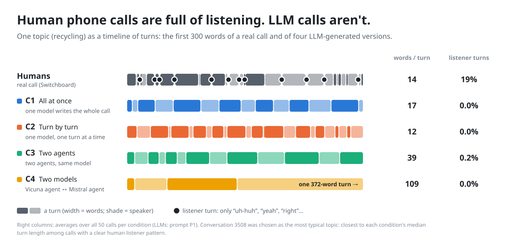
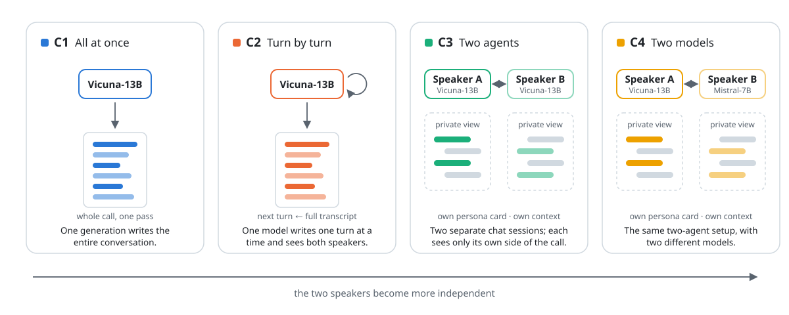
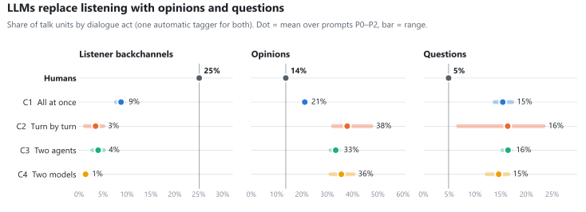
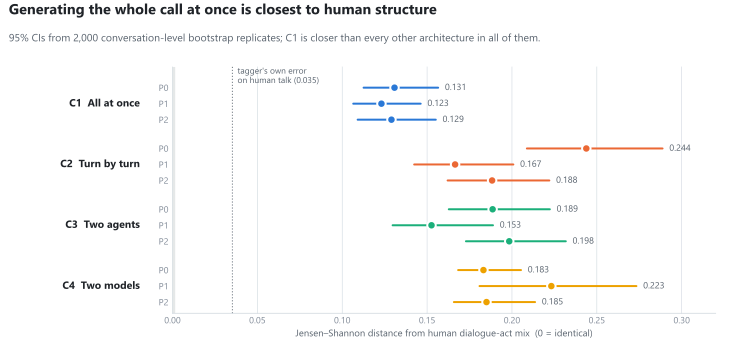
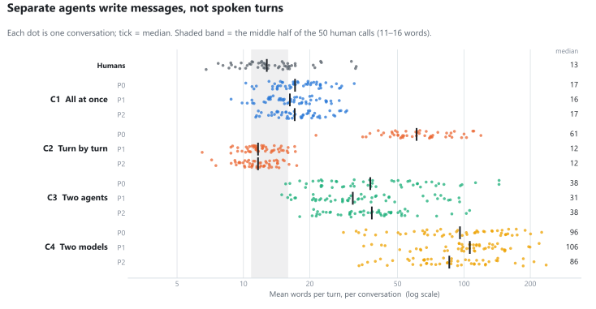
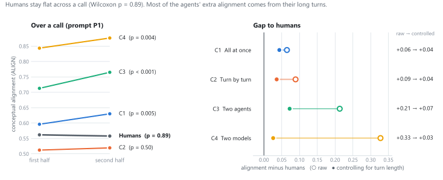
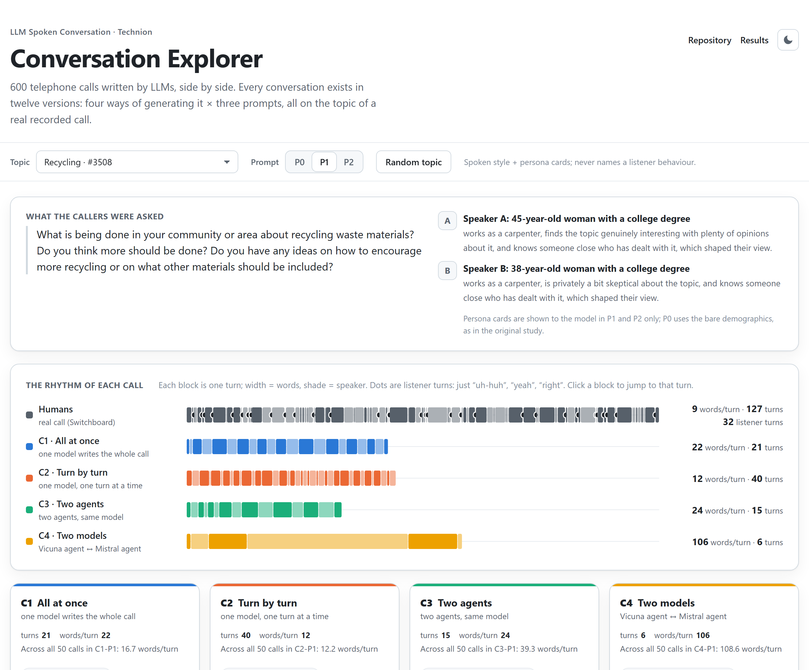

<div align="center">

# Can LLMs hold a phone conversation?

**How the way a conversation is generated shapes its structure:<br>600 LLM-simulated telephone calls compared with real human ones.**

[](https://github.com/diyarh26/llm-spoken-conversation/actions/workflows/ci.yml)
[](pyproject.toml)
[](https://github.com/astral-sh/ruff)
[](LICENSE)
[](docs/data.md#license)

[**Explore the conversations**](https://diyarh26.github.io/llm-spoken-conversation/) ·
[Results report](results/RESULTS_REPORT.md) ·
[Methods](docs/methods.md) ·
[Data card](docs/data.md) ·
[Poster (PDF)](poster/poster.pdf)

Amal Marjieh · Sham Alem · Aleen Nijim · Diyar Husayyan<br>
<sub>Technion – Israel Institute of Technology · Faculty of Data and Decision Sciences · 2026</sub>

</div>

<br>

<picture>
  <source media="(prefers-color-scheme: dark)" srcset="docs/assets/hero-dark.svg">
  
</picture>

## TL;DR

LLMs are increasingly used to *simulate* conversations: as synthetic training data, in social
simulations, and as stand-ins for human participants. We generated **600 telephone calls**
with open-source LLMs, crossing **four generation architectures** with **three prompts**, and
compared their structure with real calls from the **Switchboard** corpus.

- **The listener is missing.** Humans spend about a quarter of their talk on “uh-huh”,
  “yeah”, “right”. Under every architecture and prompt, at most **0.4%** of LLM talk units
  are standalone listener turns, against **19%** for humans.
- **Architecture matters more than the prompt.** Writing the whole call at once (C1) is the
  closest to human structure. Giving each speaker its own agent moves the structure *further*
  away. The choice of architecture moves the distance from human talk **3.6× more** than the
  choice of prompt.
- **Agents write messages, not spoken turns:** up to **7× longer** than human turns.
- **LLM speakers converge on each other; humans don't.** Most of that extra alignment is
  explained by turn length.

## Why it matters

[Mayor, Bietti & Bangerter (2025)](https://doi.org/10.1111/cogs.70106) showed that LLM-written
phone calls differ from human ones, but they varied only the prompt and the model, and a
single model always wrote both sides. Real simulation pipelines differ in something else:
**whether one model writes the dialogue or separate agents talk to each other.** This project
isolates that factor, keeps every prompt free of the behaviours being measured, and adds a
structural measure, dialogue acts, that captures *what each turn does*.

## Design

<picture>
  <source media="(prefers-color-scheme: dark)" srcset="docs/assets/architectures-dark.svg">
  
</picture>

**4 architectures × 3 prompts = 12 conditions, × 50 conversations = 600.** The design is
paired: every condition generates the *same* 50 conversations, each seeded with the topic and
caller demographics of a real Switchboard call, so differences between conditions are not
differences in topic or speakers.

| Prompt | What the model is told |
|---|---|
| **P0** · paper prompt | The original study's basic prompt (replication anchor) |
| **P1** · spoken style | Spoken register and brevity, a seeded persona card per speaker, peer framing; **never names a listener behaviour** |
| **P2** · real examples | P1 + two short excerpts from real Switchboard calls on other topics |

**Models:** Vicuna-13B v1.5 (all architectures) and Mistral-7B-Instruct (speaker B in C4),
4-bit quantized on a single GPU. The poster labels C3/C4 as A3/A4.

## Results

### 1. LLMs replace listening with opinions and questions

<picture>
  <source media="(prefers-color-scheme: dark)" srcset="docs/assets/fig-acts-dark.svg">
  
</picture>

Every unit of talk is labelled with what it does (statement, opinion, backchannel,
question…). Humans and LLMs are labelled by the **same** automatic tagger, so the comparison
is like-for-like. The tagger's 8–9% backchannels for C1 are mostly turns that *start* with
“Yeah, …” and carry on: counted literally, only 0.0–0.4% of LLM units are listener-only,
against 19% for humans.

### 2. Generating the whole call at once is closest to human structure

<picture>
  <source media="(prefers-color-scheme: dark)" srcset="docs/assets/fig-distance-dark.svg">
  
</picture>

C1 is closer to human structure than every other architecture in **100% of 2,000**
conversation-level bootstrap replicates. Averaged over prompts, the architectures span 0.072
in distance while the prompts span 0.020. Every gap is far above both the tagger's own error on
human speech (0.035) and the sampling noise floor (≤ 0.002).

### 3. Separate agents write messages, not spoken turns

<picture>
  <source media="(prefers-color-scheme: dark)" srcset="docs/assets/fig-turn-length-dark.svg">
  
</picture>

<details>
<summary><b>Read an excerpt:</b> the same topic and speakers, two architectures (prompt P1)</summary>

<br>

**C1 · one model writes the whole call**

> **A:** Hi there, how are you doing today?<br>
> **B:** I'm doing well, thanks. How about you?<br>
> **A:** I'm good, thanks for asking. So, I heard we're going to talk about recycling today. That's a pretty interesting topic, isn't it?<br>
> **B:** Yeah, I guess so. I mean, it's important and all, but I don't know if I have that much to say about it.

**C4 · a Vicuna agent talking to a Mistral agent**

> **A:** So, have you been doing much recycling in your area?<br>
> **B:** Yes, we have a curbside recycling program for paper, plastic, glass, and metal. But it seems not everyone participates, and some materials like organic waste and electronics are not included. You? What about where you live? How's the recycling situation there?<br>
> **A:** We have a similar program, but I think more could be done. A lot of people still don't recycle properly or at all. […89 words]<br>
> **B:** Absolutely. I agree that education and incentives are key. Some of my neighbors don't even know what can be recycled […] *(372 words in one turn, in which it invents the partner's replies: “Interesting ideas! I've heard of some communities…”)*

Compare all twelve versions of any conversation in the [explorer](https://diyarh26.github.io/llm-spoken-conversation/#3508/P1).

</details>

### 4. LLM speakers converge on each other; humans don't

<picture>
  <source media="(prefers-color-scheme: dark)" srcset="docs/assets/fig-alignment-dark.svg">
  
</picture>

Adjacent-turn alignment ([ALIGN](https://github.com/nickduran/align-linguistic-alignment),
Duran et al., 2019) stays flat across a human call but rises in 9 of 12 LLM conditions. We
report the caveat rather than hide it: averaged word vectors of long turns look alike, and
controlling for turn length removes most of the agents' raw “over-alignment”. Full tables,
statistics and robustness checks are in the **[results report](results/RESULTS_REPORT.md)**.

## Explore the conversations

<a href="https://diyarh26.github.io/llm-spoken-conversation/">
  <picture>
    <source media="(prefers-color-scheme: dark)" srcset="docs/assets/explorer-dark.png">
    
  </picture>
</a>

The **[conversation explorer](https://diyarh26.github.io/llm-spoken-conversation/)** puts all
twelve versions of any call side by side, with the rhythm of every version next to the real
human call's. Click any turn block to jump to it in the transcript.

## Why the findings hold up

| Safeguard | What we did |
|---|---|
| **Replicate before generating** | The pipeline first reproduced the original study's human numbers: 14.4 words per turn (paper: 13.97), “uh-huh” 1.03 per 100 words (paper: 1.03), first-half alignment 0.56 (paper: ≈ 0.57). |
| **No circular prompts** | No prompt in the main design names or shows a measured behaviour; an automated test enforces it. |
| **Decoding can't hide the effect** | An audit showed that common anti-repetition settings make backchannels *impossible* (a 16-token minimum, repetition penalties). They were switched off, and loops are handled by resampling instead. |
| **One ruler for both sides** | Humans and LLMs are tagged by the same tagger, the tagger's own error is reported, and every distance is compared with a size-matched noise floor and a conversation-level bootstrap. |
| **Tagger checked by hand** | Four annotators labelled 100 LLM units: 77% agreement with the tagger (95% CI 67–84%), inter-annotator κ = 0.67. Its main error under-counts LLM opinions, so the reported gap is conservative. |
| **Degeneration reported, not patched** | Echo loops and language drift are measured per condition; removing them changes every distance by ≤ 0.01. |
| **Tested code** | 149 tests run in CI on Python 3.10–3.13, covering turn cleaning, the generation loop (with stub models), prompt rules, all 600 data files, and the headline claims above. |

The full protocol, including every declared caveat, is in **[docs/methods.md](docs/methods.md)**.

## Repository

```
├── generation/             one resumable script per architecture + a shared, tested core
│   ├── generate_c1.py … generate_c4.py
│   ├── turnwise.py         turn-by-turn loop and quality guards (torch-free)
│   ├── cleaning.py         raw model output → exactly one spoken turn
│   ├── runner.py           CLI, resumable jobs, output records
│   ├── model_utils.py      4-bit model loading and chat generation
│   ├── config.py           models and frozen decoding settings
│   └── sampling.py         seeded, topic-stratified sample (target_ids.json)
├── prompts/                P0–P2 templates and per-architecture views; rendered examples
├── analysis/               dialogue acts, metrics, ALIGN, statistics, figures
├── data/generated/         the 600 conversations (12 folders × 50 JSON files)
├── results/                every table and statistic behind the figures + RESULTS_REPORT.md
├── explorer/               the conversation explorer (static site, deployed to GitHub Pages)
├── annotation/             human validation of the dialogue-act tagger
├── docs/                   methods, data card, README figures
├── poster/                 the poster (PNG, PDF) and its figures
└── tests/                  149 tests: no GPU or licensed data needed
```

## Quickstart

```bash
git clone https://github.com/diyarh26/llm-spoken-conversation.git
cd llm-spoken-conversation
pip install -e ".[analysis,dev]"

make test       # 149 tests in about a second
make figures    # rebuild every README figure from results/
make serve      # browse the conversations at http://localhost:8000
```

**Full pipeline.** Generation needs a CUDA GPU: `pip install -e ".[generation]"`, then
`make generate` (resumable; each conversation is saved as soon as it finishes). The exact
package versions of the published run are in
[`environment/generation-lock.txt`](environment/generation-lock.txt). Recomputing the human
side needs the Switchboard Dialog Act corpus, which is licensed by the LDC and not included:
place it under `data/switchboard/swda/` and run `make analysis`. The dialogue-act tagger and
ALIGN run in their own environments; see [Methods § Reproducing](docs/methods.md#11-reproducing).

## Limitations

Two open model families, 4-bit quantized; 50 conversations per condition; strictly alternating
turns, unlike real overlapping speech; and automatic dialogue-act tagging, whose error is
measured but not zero. Turn length is the one dimension the P1/P2 prompts instruct.
See [Methods § Declared caveats](docs/methods.md#10-declared-caveats).

## Citation

```bibtex
@software{marjieh2026llmspokenconversation,
  author = {Marjieh, Amal and Alem, Sham and Nijim, Aleen and Husayyan, Diyar},
  title  = {LLM Spoken Conversation: generation architecture vs. prompting in simulated telephone calls},
  year   = {2026},
  url    = {https://github.com/diyarh26/llm-spoken-conversation}
}

@article{mayor2025llmconversations,
  author  = {Mayor, Eric and Bietti, Lucas M. and Bangerter, Adrian},
  title   = {Can Large Language Models Simulate Spoken Human Conversations?},
  journal = {Cognitive Science},
  volume  = {49},
  pages   = {e70106},
  year    = {2025},
  doi     = {10.1111/cogs.70106}
}
```

## Acknowledgments

Built as a research project in the Faculty of Data and Decision Sciences at the Technion. It
extends Mayor, Bietti & Bangerter (2025) and ports their released analysis code for the
replication. We use the [Switchboard Dialog Act Corpus](https://github.com/cgpotts/swda)
(LDC), [ALIGN](https://github.com/nickduran/align-linguistic-alignment) (Duran, Paxton &
Fusaroli, 2019) and [DialogTag](https://github.com/bhavitvyamalik/DialogTag).

## License

Code: [MIT](LICENSE). Generated conversations and derived results:
[CC BY 4.0](https://creativecommons.org/licenses/by/4.0/); the upstream model licenses may also
apply ([data card](docs/data.md#license)). No Switchboard transcript text is included.
