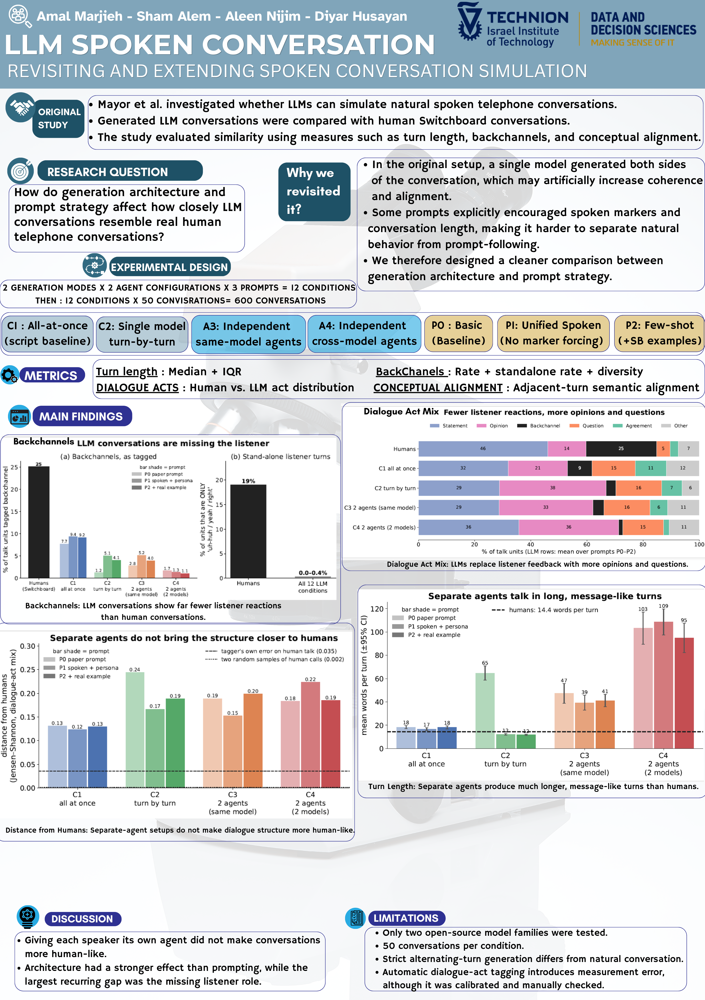
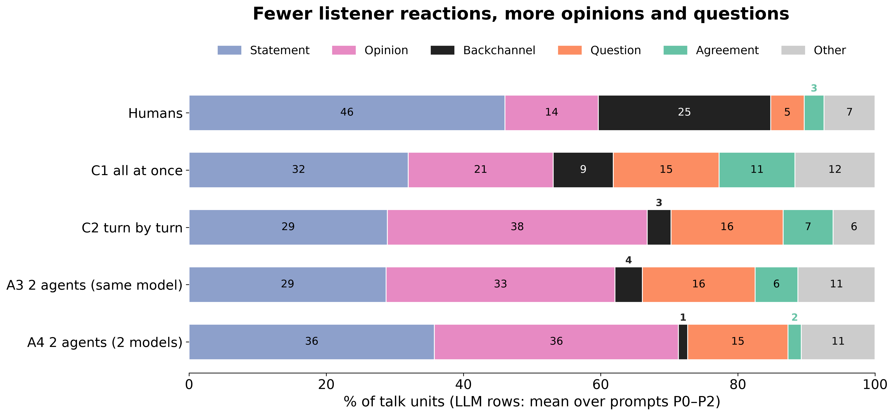
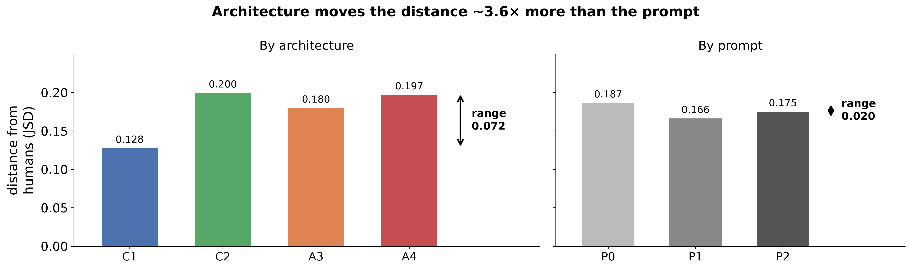
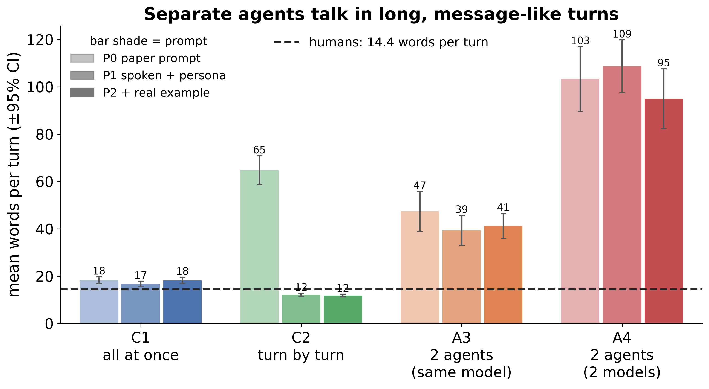

# Can LLMs Simulate Spoken Conversation? — Generation Architecture vs. Prompting

**Technion · Faculty of Data and Decision Sciences · Research project, 2026**
Amal Marjieh · Sham Alem · Aleen Nijim · Diyar Husayyan

We generated **600 simulated telephone conversations** with open-source LLMs and compared their
interactional structure to **real human phone calls (Switchboard corpus)**. The study separates
the effect of **how a conversation is generated** (one model writing the whole dialogue vs. two
independent agents talking to each other) from the effect of **how the model is prompted**.

> **Main result:** generating the whole conversation at once is closest to human talk.
> Giving each speaker its own agent makes conversations *less* human-like. Architecture moves
> the distance from human structure **~3.6× more than the prompt does**. In every setup the
> listener role is missing: humans spend ~25% of their talk on "uh-huh / yeah / right";
> LLMs almost never produce a standalone listener turn (0.0–0.4% vs. 19% for humans).



---

## Motivation

[Mayor, Bietti & Bangerter (2025), *Can Large Language Models Simulate Spoken Human Conversations?*](https://doi.org/10.1111/cogs.70106)
compared LLM-generated conversations to Switchboard. In their setup a single model wrote
**both** sides of the conversation, and some prompts explicitly asked for spoken markers
("oh", "uh-huh"), which are among the very features being measured. We redesigned the
experiment so that **architecture, prompt, and model identity** can each be isolated, and we
added a new structural metric based on dialogue acts.

## Experimental design

**4 architectures × 3 prompts = 12 conditions, × 50 conversations = 600 conversations.**
All 12 conditions use the same 50 topics, taken from 50 real Switchboard calls that also serve
as the human reference.

| | Architecture | How it works |
|---|---|---|
| **C1** | All-at-once | One model writes the entire conversation in a single generation |
| **C2** | Single model, turn-by-turn | One model produces the next turn given the history, alternating speakers |
| **C3** | Independent same-model agents | Two separate Vicuna agents, each with its own persona and view of the dialogue |
| **C4** | Independent cross-model agents | Vicuna ↔ Mistral, so the speakers differ in model identity too |

| | Prompt | |
|---|---|---|
| **P0** | Basic | The original paper's baseline prompt |
| **P1** | Spoken style + persona | Spoken register and persona cards, with **no** instruction to use markers (avoids circular evaluation) |
| **P2** | P1 + real example | P1 plus a real Switchboard excerpt as an in-context example |

**Models:** Vicuna-13B v1.5 (all architectures) and Mistral-7B-Instruct (second agent in C4),
4-bit quantized and run on a single GPU. *(The poster labels C3/C4 as A3/A4.)*

## Metrics

| Metric | What it captures | Tooling |
|---|---|---|
| **Turn length** | Words per turn (mean, median, IQR) | custom |
| **Backchannels** | Rate of "uh-huh / yeah / right", standalone listener turns, lexical diversity | custom lexicon |
| **Dialogue-act structure** | Distribution and transitions of dialogue acts (statement, opinion, backchannel, question…), Jensen–Shannon distance from humans | [DialogTag](https://pypi.org/project/DialogTag/) (DAMSL / SWDA tag set) |
| **Conceptual alignment** | Semantic similarity between adjacent turns, first vs. second half of the call | [ALIGN](https://github.com/nickduran/align-linguistic-alignment) (Duran et al., 2019), word2vec |

**Statistics:** Kruskal–Wallis tests, mixed-effects models (`words ~ corpus × section + (1 | conversation)`),
Wilcoxon tests for alignment change, bootstrap confidence intervals, and a noise floor
(distance between random samples of human calls) for every JSD.

## Key findings

**1. LLMs replace listening with opinions and questions.**


**2. Architecture matters more than prompting.** C1 (all-at-once) is closest to humans
(JSD 0.128). Splitting the speakers into agents moves the structure *further* away (0.18–0.20).
Every gap is far above the tagger's own error (0.035) and the sampling noise (≈0.002).


**3. Separate agents write messages, not spoken turns:** up to 7× longer than human turns.
Below is an excerpt from the same topic in C4 (two agents): the turns read like chat messages.

> **A:** I also enjoy reading mystery novels, but I also like to read self-help books. They help me improve my skills and knowledge in different areas of my life.
> **B:** Oh, interesting! I've dabbled in self-help books before, but I find that I mostly gravitate towards fiction. It's a nice escape from reality for me. Do you have a favorite self-help book or author? Also, have you read any good mystery novels lately that you'd recommend? …



**4. LLM speakers converge, humans don't.** Adjacent-turn alignment stays flat across a human
call (p = 0.89) but rises in 9 of 12 LLM conditions. After controlling for turn length, most of
the raw "over-alignment" of agent architectures disappears. We report this rather than hide it.

The full write-up with all tables, statistics, robustness checks and data-quality audit is in
**[results/RESULTS_REPORT.md](results/RESULTS_REPORT.md)**.

## Validity checks

- **Replication first:** before generating any new data, our pipeline reproduced the paper's
  human Switchboard numbers: 14.4 words/turn (paper: 13.97) and uh-huh 1.03 per 100 words
  (paper: 1.03).
- **Tagger validated on LLM text:** 4 annotators hand-labelled 100 LLM sentences. The tagger
  matched them 77% of the time (95% CI 67–84%), and the annotators agreed with each other 83%
  of the time (Fleiss' κ = 0.67). See [annotation/](annotation/) and
  [results/tagger_handcheck.txt](results/tagger_handcheck.txt).
- **Robustness:** removing echo-loop turns or the conversations where the model drifted into
  another language changes every distance by ≤ 0.01.
- **Data quality reported, not patched:** loop rates and language drift per condition are
  documented in the report (§4).

## Repository structure

```
├── prompts/
│   ├── templates.py          # P0/P1/P2 prompt + chat-message builders for every architecture
│   └── PROMPT_EXAMPLES.md    # readable examples of every prompt
├── generation/
│   ├── generate_c1.py … generate_c4.py   # one resumable script per architecture
│   ├── model_utils.py        # 4-bit model loading, chat templating, loop-guarded turn generation
│   ├── config.py             # frozen decoding parameters per architecture
│   ├── sampling.py           # topic / persona sampling from Switchboard metadata
│   ├── quality.py, degeneration_score.py   # loop detection and degeneration scoring
│   ├── run_all.sh            # runs all 12 conditions (in tmux)
│   └── GENERATION_SPEC.md    # full generation specification
├── analysis/
│   ├── swda.py               # Switchboard (SWDA) loader
│   ├── analyze.py, metrics.py           # turn cleaning, words/turn, marker rates
│   ├── evaluate_generated.py # per-conversation + per-condition metrics
│   ├── dialogue_acts.py      # dialogue-act tagging, distributions, transitions, JSD
│   ├── jsd_bootstrap.py, transition_weighted.py
│   ├── export_align.py, alignment_checks.py   # ALIGN conceptual alignment + length control
│   ├── stats.py              # Kruskal–Wallis, mixed-effects models
│   ├── original_paper_analysis.py   # port of the original paper's R analyses (replication)
│   ├── make_annotation_sheets.py, score_annotation.py   # human validation of the tagger
│   ├── poster_figures.py     # all figures
│   └── test_dialogue_acts.py # unit tests
├── data/
│   ├── generated/<condition>/<id>.json   # the 600 generated conversations
│   └── align/alignment_turns.csv         # per-turn ALIGN scores
├── annotation/               # tagger hand-check: blank and filled annotation sheets
├── results/                  # tables, statistics, figures, RESULTS_REPORT.md
└── poster/poster.png
```

## Reproducing

```bash
# Environment (GPU needed for generation only)
pip install torch --index-url https://download.pytorch.org/whl/cu118   # match your CUDA
pip install -r requirements.txt

# 1. Generate all 12 conditions (resumable; every conversation is written to disk immediately)
bash generation/run_all.sh

# 2. Analysis
python analysis/evaluate_generated.py --data_dir data/generated --out_dir results --switchboard
python analysis/dialogue_acts.py --generated-root data/generated --out-dir results/dialogue_acts
python analysis/transition_weighted.py results/dialogue_acts
python analysis/stats.py --data-dir data/generated > results/stats_report.txt
python analysis/export_align.py --data-dir data/generated --include-sb
python analysis/alignment_checks.py --out results
python analysis/poster_figures.py

# Unit tests
python -m unittest analysis.test_dialogue_acts
```

The dialogue-act tagger runs in its own environment ([analysis/requirements-dialogue-acts.txt](analysis/requirements-dialogue-acts.txt)).
ALIGN is installed separately, following the original authors' OSF notebooks.

**Data note:** Switchboard is licensed by the LDC and is **not** included in this repository.
Only our own generated conversations and numeric results are committed. Place the SWDA corpus
under `data/switchboard/` to rerun the human-side analysis.

## Limitations

- Only two open-source model families (Vicuna, Mistral) were tested.
- 50 conversations per condition.
- Strict turn-taking differs from natural overlapping speech, and automatic dialogue-act tagging
  introduces measurement error (quantified above).

## Reference

Mayor, E., Bietti, L. M., & Bangerter, A. (2025). Can Large Language Models Simulate Spoken
Human Conversations? *Cognitive Science*, 49, e70106. https://doi.org/10.1111/cogs.70106
